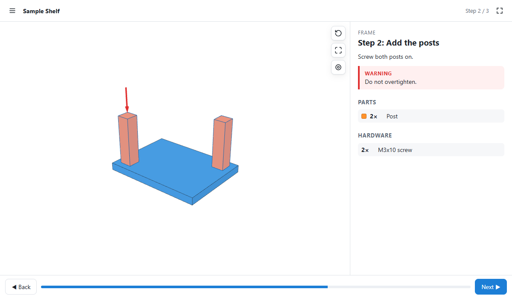

# Guide Viewer

A read-only 3D viewer for assembly guides made with [Guide Builder](../_guide_builder/). The whole viewer is one HTML file, `guide-viewer.html`. You can open it directly, put it on any web host, or embed it in another page with an `<iframe>`.

**[Try the live demo](https://hannabanaaahh.github.io/3D-guide-viewer/)**: click the picture to open the example guide in 3D.

[](https://hannabanaaahh.github.io/3D-guide-viewer/guide-viewer.html?src=examples/sample.guide)

Readers can:

- step through the guide with the buttons, the arrow keys, or the step list
- turn, zoom and pan the model (drag, scroll or pinch), then reset to the step's view with **R** or the reset button
- read each step's text, tips, warnings, parts and hardware, and open its photos
- hover over a part (or tap it on a touch screen) to see its name, and click a part in the step's parts list to make it flash
- turn the hole markers on and off

Moves between steps are animated. The animation is turned off when the reader's system asks for reduced motion. The page works at phone width.

There are four themes: **Light**, **Dark**, **Whimsy** (pastel storybook with polka dots and a rainbow progress bar) and **Girly pop** (bubblegum pink with sparkles and glossy buttons). Readers pick one with the palette button. Their choice is remembered in their browser; until they choose, the viewer follows their system's light or dark mode. Light and Dark use the accent colour set in the guide, and the two other themes use their own colours.

## Load a guide

There are three ways:

1. **Embedded data.** In Guide Builder, click **Export HTML**. You get a copy of this viewer with your guide inside it, as one file you can share or host.
2. **`?src=`.** Save your project as a `.guide` file in Guide Builder, put it next to the viewer, and open
   `guide-viewer.html?src=my-guide.guide`. The file can be on another site if that site allows cross-origin requests (CORS).
3. **Open or drop a file.** Open `guide-viewer.html` with no guide and drop a `.guide` file on it.

The viewer loads three.js, JSZip, marked and DOMPurify from the jsDelivr CDN, so readers need an internet connection.

## Embed

```html
<iframe src="https://example.com/guide-viewer.html?src=shelf.guide"
        style="width:100%;height:640px;border:0"
        allow="fullscreen" title="Assembly guide"></iframe>
```

An exported guide works the same way: `<iframe src="shelf.html" …>`.

### Options

Add these to the address as a query string, for example `?src=shelf.guide&step=3&theme=dark`.

| Option | Values | Default | What it does |
|---|---|---|---|
| `src` | URL | — | The `.guide` file to load |
| `step` | number | `0` | Page to open first. `0` is the introduction, `1` is step 1. `#step=N` in the address does the same and is kept up to date as the reader moves. |
| `intro` | `0` | shown | `intro=0` hides the introduction page. `step=0` is then step 1. |
| `theme` | `light`, `dark`, `whimsy`, `girlypop` | the reader's last pick, else their system setting | Theme to start with. Readers can change it with the palette button. |
| `themes` | `0` | shown | `themes=0` hides the theme button |
| `panel` | `side`, `bottom`, `none` | `side` | Where the step text goes. `none` shows only the 3D view and the step buttons. |
| `bg` | CSS colour, for example `%23ffffff` | theme colour | Background of the 3D view (`%23` is `#`) |
| `wait` | `1` | — | When embedded with no guide, show a loading spinner and wait for a `guide:load` message instead of asking for a file |

On screens narrower than 860 px, the text is always shown under the 3D view.

### Control it from the host page

The host page can talk to the viewer with `postMessage`. The viewer only accepts messages from the page that embeds it.

```js
const viewer = document.querySelector('iframe').contentWindow;

viewer.postMessage({ type: 'guide:goto', step: 4 }, '*');   // 0 = introduction
viewer.postMessage({ type: 'guide:next' }, '*');
viewer.postMessage({ type: 'guide:prev' }, '*');
viewer.postMessage({ type: 'guide:theme', theme: 'whimsy' }, '*');  // light, dark, whimsy, girlypop
viewer.postMessage({ type: 'guide:load', url: '/guides/shelf.guide' }, '*');
viewer.postMessage({ type: 'guide:load', data: arrayBufferOrBlob }, '*');

window.addEventListener('message', (e) => {
  if (e.data?.type === 'guide:ready') console.log(e.data.title, e.data.steps, 'steps');
  if (e.data?.type === 'guide:step') console.log('now on', e.data.step, e.data.title);
});
```

| Message from the viewer | Fields |
|---|---|
| `guide:ready` | `title`, `steps` (number of steps), `intro` (whether the introduction page is shown) |
| `guide:step` | `step` (page number), `index` (step index from 0, or -1 for the introduction), `id`, `title` |

## Host it on GitHub Pages

This repository is ready to publish as a website. `index.html` is a demo page that embeds the viewer with the example in `examples/sample.guide`.

1. On GitHub, open **Settings → Pages**.
2. Under **Build and deployment**, choose **Deploy from a branch**, pick `main` and `/ (root)`, and save.
3. After a minute the site is at `https://USERNAME.github.io/REPO/`.

Your own guides work the same way: add the `.guide` file to the repository and link to `guide-viewer.html?src=path/to/file.guide`.

## Security

Guides are treated as untrusted data. Markdown is cleaned with DOMPurify before it is shown, links open in a new tab, only `data:image/…` photos are shown, and colours are checked before use. A guide cannot run scripts in the page.

## Run it offline

To use the viewer without internet, download the four libraries named in the `<script>` and `importmap` tags at the top of `guide-viewer.html`, put them next to it, and change those addresses to the local files.

## The .guide format

A `.guide` file is a zip:

| Path | Contents |
|---|---|
| `project.json` | Guide text, settings, parts, hole markers, and the steps with each part's position, rotation and look, plus camera, callouts and arrows |
| `geom/<key>.bin` | Triangle positions for one mesh as little-endian float32 (x, y, z for each vertex, 3 vertices per triangle, in mm, Z up) |
| `images/<id>.txt` | One photo as a `data:image/…` URL |

## License

[MIT](LICENSE). The libraries loaded from the CDN keep their own licenses: three.js, JSZip and marked are MIT, and DOMPurify is Apache-2.0 or MPL-2.0.
